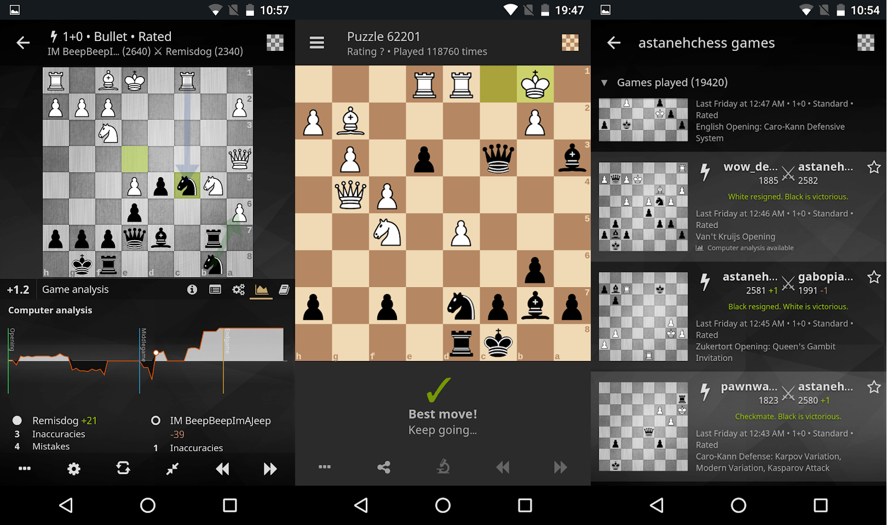

Lichess OG: lichobile 7.15.2, kept working
==========================================

This is the old lichess.org mobile app ([lichobile](https://github.com/lichess-org/lichobile))
at version 7.15.2, with only the changes needed for it to keep working against
today's lichess.org server ([lila](https://github.com/lichess-org/lila)). It is
not an official lichess.org app. License: GPL-3.0-or-later, same as upstream.

What differs from 7.15.2:

* Server calls that lichess.org removed, moved or switched off for this app are
  pointed at their current equivalents (puzzles, timeline, streamers, player
  search, analysis, forecasts, notes, opening explorer, preferences, follow /
  block, tournaments). Screens are unchanged.
* No push notifications: they need Firebase credentials owned by lichess.org.
* Sign-up opens the lichess.org website: the server refuses sign-ups from this app.
* The "please upgrade" pop-up is gone.
* Android application id is `org.lichess.mobileapp.og`, so it installs next to
  the official apps. Minimum Android version is 5.1.

Build the Android APK (Node 22, JDK 17, Android SDK 30 + NDK 23.1.7779620):

    npm ci
    APP_MODE=release APP_CONFIG=prod npm run build
    npx cap sync android
    (cd node_modules/capacitor-stockfish/stockfish/src && make net)
    (cd android && ./gradlew assembleDebug)

The original README follows.

[lichess.org/mobile](http://lichess.org/mobile)
--------------------

Lichess mobile is the lichess.org official application. It is written
in [TypeScript](http://www.typescriptlang.org/), with a bit of Kotlin and Swift.
It is a web application that accesses the native SDK, thanks to [Ionic capacitor](https://capacitor.ionicframework.com/).
The rendering library is [mithril.js](http://mithril.js.org/).
It talks to a native [Stockfish](https://stockfishchess.org/) engine, [supporting multiple variants](https://github.com/ddugovic/Stockfish), through a
[capacitor plugin](https://github.com/veloce/capacitor-stockfish).
Multi-variant chess library is brought by [a JavaScript version of scalachess](https://github.com/veloce/scalachessjs).

## Required dependencies

* [node](http://nodejs.org) latest LTS version
* [ionic capacitor dependencies](https://capacitorjs.com/docs/getting-started/environment-setup)

**Android:**

* in addition to capacitor dependencies, [android ndk](http://developer.android.com/tools/sdk/ndk/index.html) for stockfish compilation (to install with Android Studio).

## Setup project

Make sure to install all dependencies:

    $ npm install

Capacitor needs the web app before sync, so build it:

    $ npm run build

Sync capacitor:

    $ npx cap sync

## Running in the browser

    $ npm run serve

Will serve assets at `http://localhost:8080`.
Once the server is up, browse to [http://localhost:8080/www](http://localhost:8080/www).

You should use a chromium based browser to be close to the android webview which
is based on chrome.

Be sure to [Toggle Device Mode](https://developers.google.com/web/tools/chrome-devtools/device-mode/)
or else you won't be able to click on anything.

## Running in a device/emulator

Be sure to install all the dependencies and follow the steps above in the [Setup
project section](#setup-project).

In order to build Stockfish, you need to download the current stockfish plugin
NNUE file and save it to the proper location for each platform:

    $ npm run fetch-nnue

### Android

Using command line:

    $ npx cap run android

Using android studio:

    $ npx cap open android

More information available [here](https://capacitorjs.com/docs/android).

### iOS

You will need a `GoogleService-Info.plist` file in order to compile iOS project.
You can download a dummy one from the [firebase open-source project](https://raw.githubusercontent.com/firebase/firebase-ios-sdk/master/Firestore/Example/App/GoogleService-Info.plist).
Put it in the `ios/App/App/` folder.
Only debug builds are allowed with that example file. Push notifications
won't work, but you will be able to run the app on a simulator just fine.

Using command line:

    $ npx cap run ios

Using Xcode:

    $ npx cap open ios

More information available [here](https://capacitorjs.com/docs/ios).

## Advanced setup

See the [wiki](https://github.com/veloce/lichobile/wiki/Setting-up-the-app-using-a-local-setup-of-lichess).
